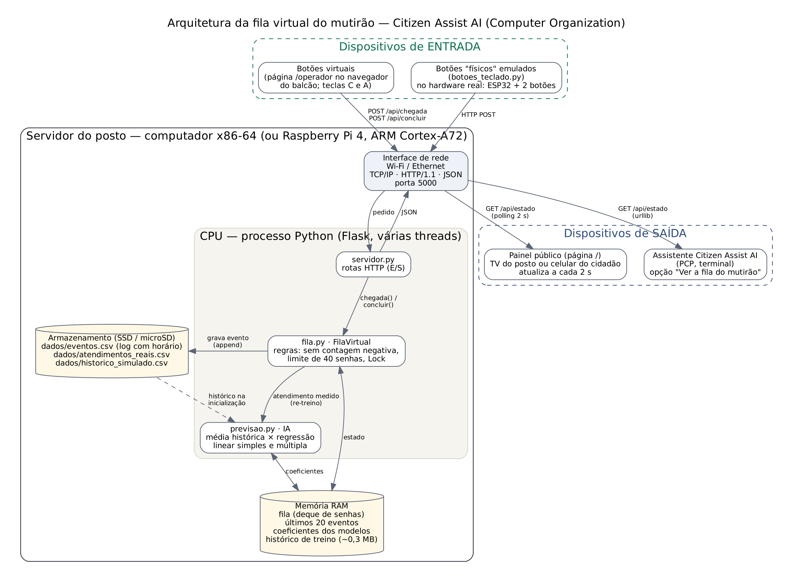
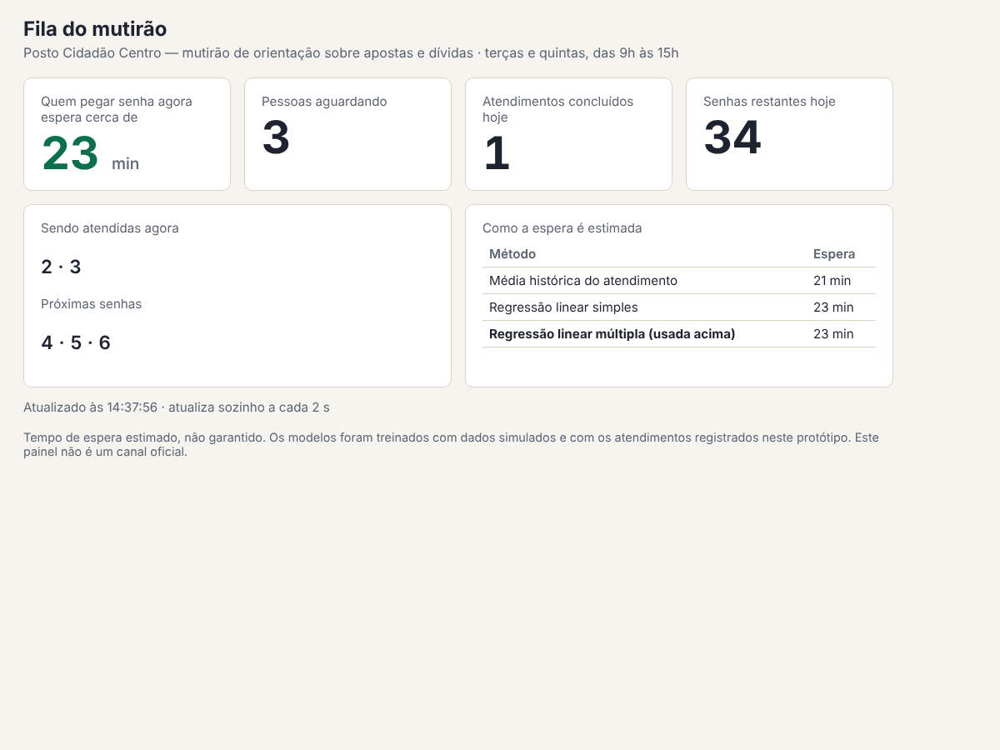
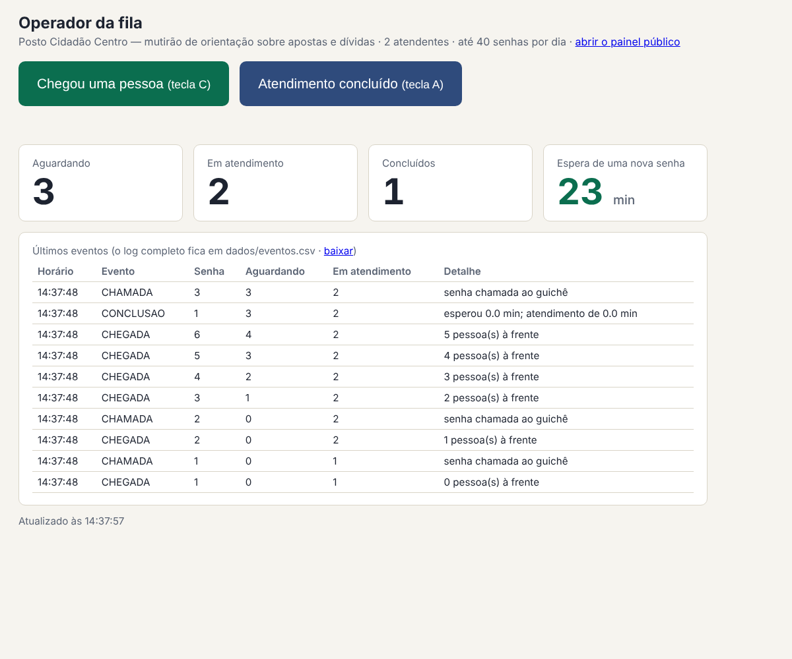

**FIAP · Ciência da Computação · Turma 1CCR**

| Integrante | RM |
|---|---|
| Enzo Ricardo Silva | 571333 |
| Eric Hernandes Penhalbel | 570237 |
| Matheus Borges Soares | 574085 |

Repositório: _(colar o link do GitHub)_ · Vídeo (até 5 min): _(colar o link do YouTube)_

# 1. Contexto e problema

O projeto Citizen Assist AI orienta pessoas que se endividaram com apostas. Na base documental do grupo, o Comunicado nº 18/2026 da Prefeitura de Vila Aurora (município fictício) cria um mutirão de orientação no Posto Cidadão Centro: terças e quintas, das 9h às 15h, com até 40 senhas por dia e sem agendamento. Sem agendamento, quem chega não sabe quanto vai esperar, e quem está em casa não sabe se ainda vale a pena ir.

O protótipo resolve isso com uma fila virtual: dois botões no balcão registram chegadas e atendimentos concluídos, um servidor mantém a fila e estima a espera com regressão linear, e um painel no navegador mostra os números para quem está no posto ou no celular. O mesmo dado chega ao assistente de terminal do projeto, que ganhou a opção "Ver a fila do mutirão".

# 2. Arquitetura do sistema



## 2.1 Componentes

| Componente | No protótipo | No posto real (proposta) | Papel |
|---|---|---|---|
| CPU | processador x86-64 do computador do grupo | Raspberry Pi 4 (ARM Cortex-A72, 4 núcleos) | executa o servidor Python: rotas HTTP, regras da fila e previsão |
| Memória RAM | RAM do computador | 2 GB do Raspberry Pi | guarda a fila (deque de senhas), os últimos 20 eventos, o histórico de treino e os coeficientes dos modelos |
| Armazenamento | SSD do computador | cartão microSD | guarda o log de eventos com horário, as esperas medidas e o histórico simulado |
| Entrada | botões virtuais na página `/operador` (teclas C e A) e `botoes_teclado.py` | ESP32 com dois botões no balcão | registra chegada e conclusão |
| Saída | painel em `/` e opção no assistente de terminal | TV do posto e celular do cidadão | mostra fila, espera estimada e atendidos |
| Comunicação | HTTP/1.1 sobre TCP/IP, mensagens em JSON, porta 5000 | Wi-Fi 802.11 da rede do posto | liga entradas, servidor e saídas |

## 2.2 Fluxo de informação

1. **Entrada.** O operador aperta "Chegou uma pessoa". O navegador (ou o ESP32, no posto real) manda `POST /api/chegada` pela interface de rede.
2. **Comunicação.** A pilha TCP/IP do sistema operacional entrega o pedido ao processo Python; o Flask cria uma thread para atendê-lo.
3. **Processamento.** A CPU executa `FilaVirtual.chegada()`: pega a trava (`Lock`), confere o limite de 40 senhas, cria a senha, coloca a pessoa no fim da fila e, se houver guichê livre, chama a senha.
4. **Memória.** A fila e os contadores ficam na RAM, onde a leitura é rápida; o evento também entra num buffer circular de 20 posições usado pelo painel.
5. **Armazenamento.** O evento é acrescentado ao fim de `dados/eventos.csv` (escrita sequencial, uma linha de cerca de 69 bytes).
6. **Previsão.** O servidor calcula a espera para quem chegar agora com os coeficientes que estão na RAM (poucas multiplicações).
7. **Saída.** A resposta JSON volta pela rede. O painel, que pede `GET /api/estado` a cada 2 s, mostra os números novos sem recarregar a página.

Na conclusão o caminho é o mesmo, com uma etapa a mais: a espera e a duração medidas são gravadas em `atendimentos_reais.csv` e os modelos são re-treinados com esse dado novo.

# 3. Implementação da fila virtual

## 3.1 Regras

| Requisito do briefing | Como o protótipo atende |
|---|---|
| Registrar chegada por um botão | `POST /api/chegada` (botão verde, tecla C ou `botoes_teclado.py`) |
| Registrar conclusão por outro botão | `POST /api/concluir` (botão azul, tecla A) |
| Atualizar automaticamente a quantidade | o estado é recalculado a cada evento e o painel consulta a cada 2 s |
| Impedir contagens negativas e operações inválidas | concluir com a fila vazia devolve HTTP 409 e não altera nada; a 41ª senha do dia é recusada; o `Lock` evita corrida entre cliques simultâneos; segurar a tecla não repete o evento |
| Exibir o total na fila | painel mostra aguardando, em atendimento e senhas restantes |
| Registrar eventos e horários | `dados/eventos.csv`: data e hora, tipo (CHEGADA, CHAMADA, CONCLUSAO, RECUSADO), senha, contagens e detalhe |

## 3.2 Medindo a espera só com dois botões

Com dois atendentes, as duas primeiras pessoas da fila estão sendo atendidas. Quando um atendimento termina, o sistema chama a próxima senha. Isso dá três instantes por pessoa: chegada, chamada e conclusão. A espera real é chamada − chegada; a duração do atendimento é conclusão − chamada. São esses dois números que alimentam a previsão.

Trecho do log gerado pelo protótipo:

```
data_hora,evento,senha,aguardando,em_atendimento,atendidos,detalhe
2026-11-13 14:37:48,RECUSADO,,0,0,0,conclusão com a fila vazia
2026-11-13 14:37:48,CHEGADA,1,0,1,0,0 pessoa(s) à frente
2026-11-13 14:37:48,CHAMADA,1,0,1,0,senha chamada ao guichê
2026-11-13 14:37:48,CHEGADA,3,1,2,0,2 pessoa(s) à frente
2026-11-13 14:37:48,CONCLUSAO,1,3,2,1,esperou 0.0 min; atendimento de 0.0 min
2026-11-13 14:37:48,CHAMADA,3,3,2,1,senha chamada ao guichê
```

(Na demonstração os botões são apertados em sequência, por isso as esperas saem em zero minuto.)

# 4. Previsão inteligente de espera

## 4.1 Dados

O briefing permite dados simulados, desde que identificados. O arquivo `dados/historico_simulado.csv` tem **637 atendimentos SIMULADOS** de 16 dias de mutirão, gerados por `simulador.py` com semente fixa (os mesmos dados toda vez). Toda linha tem a coluna `origem = SIMULADO`. Premissas da simulação:

- 10 a 16 pessoas já esperando na abertura; depois, uma chegada a cada 7 min em média até 11h e a cada 12 min depois;
- até 40 senhas por dia;
- 2 atendentes; das 12h às 13h um deles almoça;
- duração do atendimento lognormal com média de cerca de 11 min;
- 8% das senhas chamadas não aparecem (o atendente espera 1 min e conclui).

Cada linha guarda o que o sistema sabe na hora da chegada (pessoas no posto, atendentes ativos) e o que aconteceu depois (espera real e duração).

## 4.2 Métodos comparados

Sejam *n* as pessoas no posto quando a nova pessoa chega e *k* os atendentes.

- **Média histórica (convencional):** espera = max(0, *n* − *k* + 1) × TMA / *k*, com TMA = tempo médio de atendimento do histórico (10,44 min). É a conta que um funcionário faria.
- **Regressão linear simples (IA):** espera = *a* + *b* × *n*, com *a* e *b* pelo método dos mínimos quadrados: *b* = cov(*n*, espera) / var(*n*), *a* = média(espera) − *b* × média(*n*). Resultado: espera = −0,90 + 4,81 × *n* (R² de treino = 0,861).
- **Regressão linear múltipla (IA, usada no painel):** espera = *b*₀ + *b*₁ × *n* + *b*₂ × *n*/*k*, resolvendo as equações normais (XᵀX)*b* = Xᵀ*y* por eliminação de Gauss, implementada no código sem bibliotecas. Resultado: espera = −1,90 + 1,92 × *n* + 5,94 × *n*/*k*.

## 4.3 Avaliação

Os modelos foram treinados com os 12 primeiros dias (478 atendimentos) e testados nos 4 últimos (159), que eles não viram.

| Método | MAE (min) | RMSE (min) | MAE no almoço (min, 14 casos) |
|---|---|---|---|
| Média histórica | 4,53 | 6,48 | 5,68 |
| Regressão linear simples | 4,52 | 6,28 | 2,27 |
| Regressão linear múltipla | **4,41** | **6,22** | **1,67** |

**Leitura.** No geral os três métodos ficam próximos: a fila é por ordem de chegada e a conta convencional já descreve bem esse processo. A regressão ganha onde a conta erra: no almoço, a média histórica supõe que a pessoa vai esperar com um atendente só, mas o segundo volta às 13h, e por isso ela superestima a espera (erros de até 16 min nos dias de teste). A regressão aprendeu com o que de fato aconteceu e errou 1,67 min em média nesse período. A regressão múltipla foi escolhida para o painel por ter o menor erro e a mesma interpretação simples: cada pessoa à frente soma cerca de 2 min, mais 6 min por pessoa por atendente.

**Atualização da estimativa.** A espera muda a cada evento, porque *n* muda. Além disso, cada atendimento concluído no protótipo entra no histórico com `origem = PROTOTIPO` e os três modelos são re-treinados na hora (0,7 ms com 637 registros).

# 5. Comunicação e visualização

| Rota | Método | Uso |
|---|---|---|
| `/` | GET | painel público |
| `/operador` | GET | botões e últimos eventos |
| `/api/estado` | GET | estado completo em JSON (fila, atendidos, espera pelos três métodos, senhas) |
| `/api/chegada` | POST | botão 1; responde 201 ou 409 |
| `/api/concluir` | POST | botão 2; responde 200 ou 409 |
| `/api/avaliacao` | GET | erro dos métodos nos dias de teste |
| `/api/eventos.csv` | GET | baixa o log |

O painel usa `fetch` a cada 2 s (polling). Se o servidor cair, ele avisa "Sem conexão com o servidor da fila" em vez de mostrar números velhos como se fossem atuais. Os números ficam numa região `aria-live`, para leitores de tela anunciarem as mudanças.





# 6. Análise da arquitetura computacional

## 6.1 Processador

O protótipo roda num processador x86-64 de uso geral (iMac do grupo, Linux, Python 3.12.3), com sistema operacional, pilha TCP/IP e interpretador Python. A carga é pequena: a mediana de processamento foi de 2,6 ms por chegada e 3,3 ms por consulta de estado, medida com `medir_desempenho.py` sem a rede. Num posto real, um Raspberry Pi 4 (ARM Cortex-A72 de 4 núcleos, arquitetura RISC de 64 bits) teria folga: o mutirão gera cerca de 120 eventos por dia e algumas consultas por segundo do painel.

O Python tem o GIL (trava global do interpretador): só uma thread executa código Python por vez. Isso não pesa aqui, porque o tempo de cada pedido é curto e quase todo de E/S. O ESP32 dos botões (Xtensa LX6 de 2 núcleos, até 240 MHz, 520 KB de SRAM, Wi-Fi integrado) não precisa processar a fila: ele só lê os botões e manda o pedido HTTP. Separar a borda (botões) do servidor é o que deixa um microcontrolador barato servir de entrada.

## 6.2 Memória

| Item | Estimativa medida |
|---|---|
| Histórico de 637 registros + modelos | cerca de 286 KiB |
| Cada pessoa na fila (dicionário com senha e horários) | cerca de 530 bytes; 1.000 chegadas somaram 521 KiB, contando objetos temporários |
| Coeficientes dos modelos | 6 números |
| Buffer de eventos do painel | 20 linhas (deque com `maxlen`, não cresce) |
| Processo inteiro (Python + Flask) | dezenas de MB, dominado pelo interpretador |

Com 40 senhas por dia, a fila nunca passa de alguns KiB. O que define o requisito de RAM é o interpretador, não os dados: por isso a proposta usa um Raspberry Pi (GB de RAM) como servidor e deixa o ESP32 (KB de RAM) só como botão.

**Armazenamento:** cerca de 69 bytes por evento; um dia de mutirão gera uns 8 KiB. Um ano de mutirão (cerca de 100 dias) cabe em menos de 1 MB. A escrita é sequencial (append), a mais barata para um cartão microSD.

## 6.3 Entrada, processamento e saída

| Etapa | Operação | Onde |
|---|---|---|
| Entrada | clique ou tecla → `POST` | navegador do operador, `botoes_teclado.py` ou ESP32 |
| Processamento | validação, atualização da fila, medição de espera e duração, previsão, re-treino | CPU, `fila.py` e `previsao.py` |
| Saída | resposta JSON; painel atualizado; linha no CSV | rede, navegador, disco |

## 6.4 Comunicação e protocolos

- **Wi-Fi 802.11 / Ethernet** na camada física e de enlace; **IP** endereça o servidor na rede do posto; **TCP** garante a entrega dos pedidos dos botões (um clique perdido seria uma pessoa a menos na fila).
- **HTTP/1.1** com métodos semânticos: `POST` muda o estado, `GET` só lê. Os códigos de status carregam a regra: 201 (senha criada), 200 (concluído), 409 (recusado por conflito com o estado da fila).
- **JSON** como formato das mensagens, legível pelo navegador, pelo assistente em Python e por um ESP32.
- O servidor escuta em `0.0.0.0:5000`, então qualquer aparelho da mesma rede abre o painel pelo IP do computador.

## 6.5 Limitações de desempenho, memória e conectividade

- **Polling:** cada tela faz uma consulta a cada 2 s. Com 10 telas são 5 pedidos por segundo, sem problema; com centenas, WebSocket ou Server-Sent Events enviariam só quando algo muda.
- **Re-treino a cada conclusão:** custa O(N) no tamanho do histórico (cerca de 10 ms por conclusão hoje, incluindo a gravação). Com anos de dados seria melhor re-treinar uma vez por dia ou usar mínimos quadrados incrementais.
- **Ponto único de falha:** se o servidor cair, os botões param. O painel avisa a perda de conexão; a fila em memória se perde, mas o log em CSV permanece e permite reconstruir o dia.
- **Sem rede:** no posto real, o ESP32 deveria guardar os cliques numa fila local e reenviar quando a conexão voltar.
- **Servidor de desenvolvimento do Flask:** suficiente para o protótipo; em produção seria um servidor WSGI e HTTPS.
- **Um botão de conclusão só:** o sistema supõe que quem foi chamado primeiro termina primeiro. Um botão por guichê mediria cada atendimento sem essa suposição.

# 7. Testes e resultados

Os testes usam um relógio falso (para medir esperas sem esperar) e arquivos temporários. Comando: `python -m unittest discover -s testes -v`. Resultado: **12 de 12 testes aprovados**.

| # | Teste | Entrada | Esperado | Obtido |
|---|---|---|---|---|
| 1 | Chegada de novos cidadãos | 4 × `POST /api/chegada` | senhas 1 a 4; 2 em atendimento, 2 aguardando | igual ao esperado |
| 2 | Conclusão de atendimentos | 3 chegadas, 12 min, 1 conclusão | senha 1 concluída com 12 min; senhas 2 e 3 em atendimento | igual ao esperado |
| 3 | Saída com fila vazia | `POST /api/concluir` sem ninguém | HTTP 409; contagem em 0; evento RECUSADO | igual ao esperado |
| 4 | Atualização da estimativa | 8 chegadas, depois 1 conclusão | espera sobe e depois cai | igual ao esperado |
| 5 | Limite de senhas | 4ª chegada com limite 3 | recusada; fila com 3 | igual ao esperado |
| 6 | Espera medida pelos botões | 3 chegadas e 3 conclusões em 15, 5 e 7 min | senha 3: espera 15 min, duração 12 min | igual ao esperado |
| 7 | Log com horário | chegada, conclusão, conclusão inválida | CHEGADA, CHAMADA, CONCLUSAO, RECUSADO | igual ao esperado |
| 8 | Cliques simultâneos | 200 threads chamando chegada | 200 pessoas, senhas 1 a 200 sem repetição | igual ao esperado |
| 9 | Regressão aprende reta exata | espera = 3 + 5n | a = 3, b = 5, R² = 1 | igual ao esperado |
| 10 | Eliminação de Gauss | sistema 3 × 3 conhecido | (2, 3, −1) | igual ao esperado |
| 11 | Média sem fila | 0, 1 e 2 pessoas, 2 guichês | 0, 0 e 5 min | igual ao esperado |
| 12 | Páginas e API | `GET /`, `/operador`, `/api/avaliacao` | 200 e JSON com MAE | igual ao esperado |

Desempenho medido no iMac do grupo (Linux x86-64, Python 3.12.3), em 14/11/2026, com `python medir_desempenho.py`:

| Medida | Resultado |
|---|---|
| `POST /api/chegada` | mediana 2,60 ms; pior 15,40 ms (1.000 pedidos) |
| `POST /api/concluir` (inclui re-treino) | mediana 9,92 ms; pior 21,86 ms (300 pedidos) |
| `GET /api/estado` | mediana 3,31 ms; pior 7,00 ms (300 pedidos) |
| Treinar a regressão múltipla (637 registros) | 0,7 ms |
| Memória: histórico de 637 registros + modelos | 286 KiB |
| Memória: 1.000 pessoas na fila + log em memória | 521 KiB (cerca de 533 bytes por chegada) |
| Bytes por evento no CSV | 69 (um dia de mutirão ≈ 8,1 KiB) |

# 8. Conclusão

O protótipo cumpre as cinco etapas: a arquitetura separa entrada, processamento, memória, armazenamento, saída e rede; os dois botões mantêm a fila sem estados inválidos e geram um log com horário; a previsão compara a média histórica com duas regressões lineares em dados simulados identificados; o painel se atualiza sozinho pela rede; e as medições mostram que a carga do mutirão é pequena para qualquer processador atual. O resultado mais útil da comparação é honesto: no funcionamento normal a conta convencional é quase tão boa quanto a IA, e a regressão vale a pena quando o posto foge da regra, como no almoço. Com dados reais do posto no lugar da simulação, o mesmo código re-treinaria os modelos sem mudança.

# Referências

- Prefeitura de Vila Aurora (fictícia). Comunicado nº 18/2026 — documento simulado da base documental do grupo (Prompt and AI, DOC02).
- FIAP. Global Solution 2026.2 — Arquitetura e Organização de Computadores: Sistema Inteligente de Gerenciamento de Filas Virtuais (briefing da atividade).
- Pallets. Flask — documentação. https://flask.palletsprojects.com/
- Python Software Foundation. Documentação de `threading`, `collections.deque`, `csv` e `tracemalloc`. https://docs.python.org/3/
- Raspberry Pi Ltd. Raspberry Pi 4 Model B — especificações. https://www.raspberrypi.com/products/raspberry-pi-4-model-b/specifications/
- Espressif Systems. ESP32 Series Datasheet. https://www.espressif.com/en/products/socs/esp32
